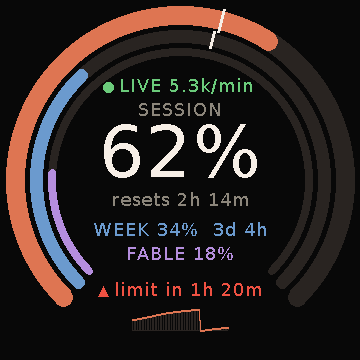

# desk-gauge

A standalone Claude usage gauge for your desk: an ESP32-S3 and a 1.8" round 360×360 screen.
It signs in to your Claude account by itself and polls your plan usage over WiFi (every 60 s by
default). No computer needs to stay on.

| Rings | Bars |
|---|---|
|  |  |

- **Outer ring:** 5-hour session. **Middle ring:** weekly limit. **Inner ring:** a model-specific
  weekly cap (Opus, Fable, ...) when your plan has one.
- **Pace tick:** the white tick shows how much of the window has passed. If the coloured arc is ahead
  of the tick, you are burning faster than an even pace.
- **Alerts:** "limit in 1h 20m" when the current rate hits 100% before the reset, `SPIKE` for a fast
  jump (5+ points in about 5 minutes), and "week on pace for 130%" for the weekly limit.
- **Sparklines:** the last 5 hours (rings) and 24 hours (bars) of session usage.
- **Faces and themes:** rings, bars, or both in rotation, in six themes (Claude, Terminal, HUD, Nord,
  Dracula, Mono). Change them at `http://desk-gauge.local/`.
- **Optional extras:** the Mac bridge adds a live `LIVE 5.3k/min` badge and "tokens today". An optional
  second screen shows a Bambu Lab printer.

```
 Anthropic (usage + OAuth) ──HTTPS──> ESP32-S3 ──QSPI──> round screen
                                         └──> http://desk-gauge.local/  (preview, sign-in, settings)
 optional: claude_usage_bridge.py ─HTTP─┘   (tokens/min, tokens today)
 optional: Bambu printer ──MQTT/TLS──────┘   (second screen)
```

## Hardware

| PlatformIO env | Board | Screen |
|---|---|---|
| `esp32s3` | ESP32-S3 DevKitC-1 **N16R8** | 1.8" ST77916 360×360 QSPI (2nd optional) |
| `esp32s3_n8r2` | ESP32-S3 DevKitC-1 **N8R2** | same |
| `esp32dev` | ESP32 DevKit V1 (WROOM-32) | none: web preview only |

The classic ESP32 DevKit V1 has no PSRAM, so it can't hold a 360×360 frame. Use it to try things out
with the web preview.

### Wiring (ESP32-S3)

Screen: DIYUSER 1.8" round, 360×360, **ST77916 over QSPI** (header: GND VCC SCL IO0 IO1 IO2 IO3 RST CS BL TE).
The pins are set in `include/config.h` (`PANEL0_PINS`, `PANEL1_PINS`).

| Screen pin | Screen 0 (Claude) | Screen 1 (printer, optional) |
|---|---|---|
| GND | GND | GND |
| VCC | 3V3 | 3V3 |
| SCL | GPIO 12 | GPIO 41 |
| IO0 | GPIO 11 | GPIO 40 |
| IO1 | GPIO 13 | GPIO 39 |
| IO2 | GPIO 14 | GPIO 2 |
| IO3 | GPIO 9 | GPIO 1 |
| RST | GPIO 8 | GPIO 21 |
| CS | GPIO 10 | GPIO 42 |
| BL | GPIO 18 | GPIO 47 |
| TE | not connected | not connected |

> The driver is LovyanGFX `Panel_ST77916` (`-DLGFX_USE_QSPI`). Its start-up settings come from the Guition JC3636W518. If colours look wrong, flip `invert` / `rgb_order` in `src/panels.h`. If the screen stays black with the backlight on, this screen needs its seller's own start-up settings.

## Setup

1. **Install PlatformIO:** `brew install platformio`
2. **Secrets:** `cp include/secrets.example.h include/secrets.h` and fill in your WiFi. Leave the printer
   lines commented out for a Claude-only gauge.
3. **Flash:**
   ```sh
   pio run -e esp32s3      -t upload && pio device monitor   # N16R8
   pio run -e esp32s3_n8r2 -t upload && pio device monitor   # N8R2
   ```
4. **Sign in:** the screen says "sign in at desk-gauge.local". Open **http://desk-gauge.local/**,
   click *Open Claude sign-in*, approve, paste the code Claude shows into the page, and click *Connect*.
   The gauge keeps its own login in flash and refreshes it by itself. You only do this once.
5. **Settings** on the same page: poll interval (30 s to 1 h), face, theme and brightness. They are
   stored on the device.

### Optional: tokens/min and tokens today

These come from Claude Code's local transcripts, so they need the bridge on the computer you use
Claude Code on:

```sh
python3 bridge/claude_usage_bridge.py          # serves :8787/claude.json
```

Then set `CLAUDE_BRIDGE_URL` in `secrets.h` and reflash.

## How the Claude data works

- **Login:** the device runs the same OAuth sign-in as Claude Code (PKCE, paste-the-code flow,
  Claude Code's public client ID). This gives it **its own** refresh token, so it never logs Claude
  Code out on your computer. Tokens are stored in the ESP32's flash (NVS). Use *Sign out* on the web
  page to remove them.
- **Usage:** `GET https://api.anthropic.com/api/oauth/usage` is the endpoint behind Claude Code's
  `/usage` screen. It returns `five_hour`, `seven_day` and `limits[]`.
  **It is undocumented and may change or break without notice.**
- **Polling:** every 60 s by default. On errors or `429` the interval doubles, up to 5 minutes, and it
  respects `Retry-After`.
- **TLS:** servers are verified against root CAs embedded in `src/root_certs.h` (Google Trust Services,
  GlobalSign, ISRG). The clock comes from NTP first.
- **History** (sparklines, burn rate) is kept in RAM and starts over after a reboot.

## Notes

- **Bambu:** the ESP connects directly to the printer (`bblp` / access code). If it can't connect on newer firmware, turn on *LAN Only* + *Developer Mode* on the printer. To see the printer's raw reports in the serial monitor, set `BAMBU_DUMP_RAW 1` in `config.h`.
- **Time zone** for the reset clock time: `TIMEZONE` in `config.h` (default Europe/Oslo).
- **`/state.json`** on the device has everything as JSON, for Home Assistant or similar.
