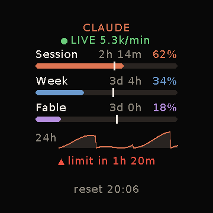

# desk-gauge

A standalone Claude usage gauge for your desk: an ESP32-S3 and a 1.8" round 360×360 screen.
It signs in to your Claude account by itself and polls your plan usage over Wi-Fi (every 5 minutes
by default). It needs only power and Wi-Fi; no computer has to stay on.

| Rings | Bars |
|---|---|
|  |  |

- **Outer ring:** 5-hour session. **Middle ring:** weekly limit. **Inner ring:** a model-specific
  weekly cap (Opus, Fable, ...) when your plan has one.
- **Pace tick:** the white tick shows how much of the window has passed. If the coloured arc is ahead
  of the tick, you are burning faster than an even pace.
- **Alerts:** "limit in 1h 20m" when the current rate hits 100% before the reset, `SPIKE` for a fast
  jump, and "week on pace for 130%" for the weekly limit.
- **Top line:** the Wi-Fi network it is on (or amber "no Wi-Fi"). **Bottom:** the local time.
- **Faces and themes:** rings, bars, or both in rotation, in six themes (Claude, Terminal, HUD, Nord,
  Dracula, Mono), set on the gauge's web page.
- **Survives restarts:** the last reading is kept in flash and shown at once after power-up, with an
  animated "loading" screen only on the very first start.
- **Optional extras:** the Mac bridge adds a live `LIVE 5.3k/min` badge and "tokens today". An optional
  second screen shows a Bambu Lab printer.

```
 Anthropic (usage + OAuth) ──HTTPS──> ESP32-S3 ──QSPI──> round screen
                                         └──> http://desk-gauge.local/ or its IP (login, settings)
 optional: claude_usage_bridge.py ─HTTP─┘   (tokens/min, tokens today)
 optional: Bambu printer ──MQTT/TLS──────┘   (second screen)
```

## Hardware

| PlatformIO env | Board | Screen |
|---|---|---|
| `esp32s3` (default) | ESP32-S3 DevKitC-1 **N16R8** (or the common clone with two USB-C ports) | 1.8" ST77916 360×360 QSPI |
| `esp32s3_ota` | same, flashed over Wi-Fi | same |
| `esp32s3_n8r2` | ESP32-S3 DevKitC-1 **N8R2** | same |
| `esp32dev` | ESP32 DevKit V1 (WROOM-32) | none: web preview only |

The classic ESP32 DevKit V1 has no PSRAM, so it can't hold a 360×360 frame. Use it to try things out
with the web preview.

### Wiring (ESP32-S3)

Screen: 1.8" round, 360×360, **ST77916 over QSPI**, FPC marked `T180-02`
(header: GND VCC SCL IO0 IO1 IO2 IO3 RST CS BL TE). The board's pins are printed as plain numbers;
those numbers are the GPIOs below. Pins are set in `include/config.h` (`PANEL0_PINS`).

| Screen pin | ESP32-S3 pin | Screen 1 (printer, optional) |
|---|---|---|
| GND | GND | GND |
| VCC | **3V3** (not 5V) | 3V3 |
| SCL | 12 | 41 |
| IO0 | 11 | 40 |
| IO1 | 13 | 39 |
| IO2 | 14 | 2 |
| IO3 | 9 | 1 |
| RST | 8 | 21 |
| CS | 10 | 42 |
| BL | 18 | 47 |
| TE | not connected | not connected |

On the two-port clone the left header reads, from the top: `3V3 3V3 RST 4 5 6 7 15 16 17 18 8 3 46 9
10 11 12 13 14 5Vin GND`, so every wire for the screen goes to that one header.

Things that cost us hours:

- **VCC must go to 3V3.** On `5Vin` the screen stays black: that pin has no power when the board runs
  from the USB port.
- **Black with the backlight on** means the screen isn't getting valid data: check SCL/IO0-IO3/CS/RST.
  The backlight works on its own (BL has a pull-up), so a lit screen proves nothing about the data wires.
- **Black looks dark grey.** It's an LCD with a backlight, not an OLED. Lower brightness helps (175 works well).
- The driver is our own (`src/panels.cpp`, ESP-IDF `spi_master`, 10 MHz). LovyanGFX's `Panel_ST77916`
  woke this screen but never showed a picture, so LovyanGFX only draws into an off-screen sprite.

## Setup

1. **Install PlatformIO:** `brew install platformio`
2. **Secrets:** `cp include/secrets.example.h include/secrets.h`, then fill in:
   - `WIFI_SSID` / `WIFI_PASS`: your main network.
   - `WIFI_SSID2` / `WIFI_PASS2` (optional): a backup, e.g. a phone hotspot. The first network always
     wins: the gauge moves back to it within about 3 minutes once it is in range again.
   - `WEB_PASS` (required): the password for the gauge's web page and for updates over Wi-Fi. The
     user name is `admin`.

   `secrets.h` is gitignored; never commit it.
3. **First flash, over USB.** Use the port marked **USB** (the native one), not COM.
   ```sh
   pio run -e esp32s3 -t upload
   ```
   If it fails with "No serial data received": hold **BOOT**, tap **RST**, let go of BOOT, then run
   the command again. Afterwards tap **RST** to start the new firmware.

   > Don't open the serial monitor on this port. Opening it can reset the board into download mode
   > (black screen, nothing happens). If that happens, tap RST. Check the gauge over the network instead.
4. **Find it on the network.** The sign-in screen shows `desk-gauge.local` and its IP address. If
   `.local` doesn't open on your computer, use the IP (or look it up in your router).
5. **Sign in to Claude:** open the page, log in with `admin` and your `WEB_PASS`, click
   *Open Claude sign-in*, approve, paste the code Claude shows into the page, and click *Connect*.
   The gauge keeps its own login in flash and refreshes it by itself. You only do this once.
6. **Settings** on the same page: poll interval (120 s to 1 h, default 300 s), face, theme,
   brightness and screen orientation (0°, 90°, 180° or 270°, to suit how the screen is mounted).
   They are stored on the device.
7. **Later updates over Wi-Fi** (no cable):
   ```sh
   GAUGE_PASS='your WEB_PASS' pio run -e esp32s3_ota -t upload --upload-port <gauge IP>
   ```

### Moving it to another Wi-Fi

The networks are compiled in. Change `WIFI_SSID`/`WIFI_PASS` (or add the new one as `WIFI_SSID2`) in
`secrets.h` and flash again, over Wi-Fi while it can still reach you, or over USB. Then it will join
the new network by itself.

### Web page security

Every page and `/state.json` needs the login. After 5 wrong passwords, logins are blocked for a
minute. Changes (settings, sign-in, sign-out) also need a header that only the page itself sends, so
another website can't make your browser change the gauge.

### Optional: tokens/min and tokens today

These come from Claude Code's local transcripts, so they need the bridge on the computer you use
Claude Code on:

```sh
python3 bridge/claude_usage_bridge.py          # serves :8787/claude.json
```

Then set `CLAUDE_BRIDGE_URL` in `secrets.h` and reflash.

## How the Claude data works

- **Login:** the device runs the same OAuth sign-in as Claude Code (PKCE, paste-the-code flow,
  Claude Code's public client ID). This gives it **its own** refresh token, so it never logs Claude
  Code out on your computer. Tokens are stored in the ESP32's flash (NVS). Use *Sign out* on the web
  page to remove them.
- **Usage:** `GET https://api.anthropic.com/api/oauth/usage` is the endpoint behind Claude Code's
  `/usage` screen. It returns `five_hour`, `seven_day` and `limits[]`.
  **It is undocumented and may change or break without notice.**
- **Polling:** every 5 minutes by default, 120 s at the fastest: the endpoint answers `429` when polled
  every minute. On errors or `429` the interval doubles, up to 5 minutes, and it respects `Retry-After`.
  After a restart the first poll waits until the saved reading is one poll interval old, so a few
  quick restarts don't trigger `429`s.
- **TLS:** servers are verified against root CAs embedded in `src/root_certs.h` (Google Trust Services,
  GlobalSign, ISRG). The clock comes from NTP first.
- **Last reading** is saved in flash after every good poll and shown right away after a restart.
  *Sign out* clears it.
- **History** (sparklines, burn rate) is kept in RAM and starts over after a reboot.

## Notes

- **Bambu:** the ESP connects directly to the printer (`bblp` / access code). If it can't connect on newer firmware, turn on *LAN Only* + *Developer Mode* on the printer. To see the printer's raw reports in the serial monitor, set `BAMBU_DUMP_RAW 1` in `config.h`.
- **Time zone** for the clock and reset times: `TIMEZONE` in `config.h` (default Europe/Oslo).
- **`/state.json`** on the device has everything as JSON (behind the same login), for Home Assistant or similar.

## Credits

Made by Roy Bringsli (FitnessProductions), built together with [Claude Code](https://claude.com/claude-code).

Standing on the shoulders of:

- **[Slmsim](https://github.com/Slmsim)**: the ST77916 start-up sequence and the way frames are sent
  to this exact screen come from
  [360-360-QSPI-Round-Display-ESP32-S3-N16R8-FFMjpeg-Player](https://github.com/Slmsim/360-360-QSPI-Round-Display-ESP32-S3-N16R8-FFMjpeg-Player)
  (`PanelInit.h`, see `src/panels.cpp`). After a day of a black screen, this is what made it work. Thank you!
- **[bozdemir/claude-usage-widget](https://github.com/bozdemir/claude-usage-widget)** (MIT): the faces,
  pace tick, alerts and themes follow its design.
- **[LovyanGFX](https://github.com/lovyan03/LovyanGFX)** by lovyan03 (FreeBSD license): draws the faces.
- **[ArduinoJson](https://github.com/bblanchon/ArduinoJson)** by Benoît Blanchon (MIT) and
  **[PubSubClient](https://github.com/knolleary/pubsubclient)** by Nick O'Leary (MIT).
- **[Arduino-ESP32](https://github.com/espressif/arduino-esp32)** and ESP-IDF by Espressif (Apache 2.0).

This is an unofficial fan project, not affiliated with or endorsed by Anthropic. Claude, the Claude
star and the Claude Code mascot belong to Anthropic. The usage data comes from the same undocumented
endpoint as Claude Code's `/usage` screen and may change without notice.

## License

- **Firmware and code:** [MIT](LICENSE). Third-party code keeps its own license (see Credits).
- **3D-printed enclosure** in [`hardware/enclosure`](hardware/enclosure): **personal,
  non-commercial use only** ([CC BY-NC-SA 4.0](https://creativecommons.org/licenses/by-nc-sa/4.0/)).
  Print it for yourself and share your remixes, but do not sell the files, printed parts or kits.
  See [`hardware/enclosure/LICENSE`](hardware/enclosure/LICENSE).
